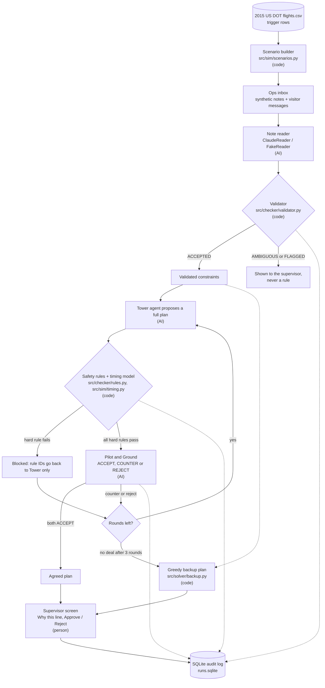
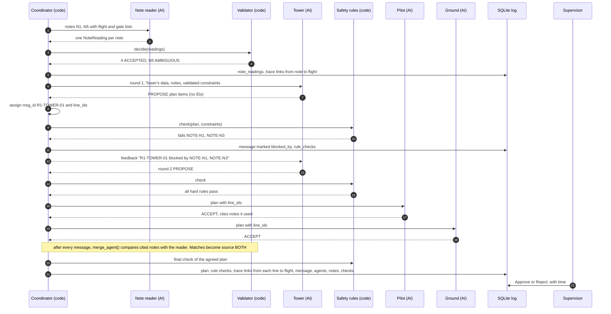

# SkyQueue

Autonomous SG 2026, AI & Aerospace track, Airbus Challenge #2.

When a storm backs up a departure queue, SkyQueue has three Claude agents (Tower, Pilot and Ground) negotiate pushback order, engines-off gate holds, moves to remote stands and runway order, in at most 3 rounds. A separate note reader turns free-text ops messages into typed answers, and a plain-Python validator decides which of those answers become rules. Plain-code safety rules check every proposed plan. If the agents don't agree inside 3 rounds, a greedy backup plan takes over, and a human supervisor approves whichever plan comes out.

- Live site: https://skyqueue.ghernie.com
- Pitch deck: https://skyqueue.ghernie.com/presentation

The site runs on a laptop behind a Cloudflare tunnel, so it is only up while that laptop is on.

## Contents

- [Architecture](#architecture)
- [Quick start](#quick-start)
- [Configuration](#configuration)
- [Safety rules](#safety-rules)
- [Data: what is real and what is made up](#data-what-is-real-and-what-is-made-up)
- [Project layout](#project-layout)
- [Known limits](#known-limits)
- [Credits and license](#credits-and-license)

## Architecture

The design rule is short: **AI suggests, code decides, a person approves.**

- Claude reads notes and proposes plans. It never decides whether a plan is legal and never does the timing arithmetic. The validator, the safety rules, the timing model and the backup plan are plain Python.
- Agents never invent IDs. Code assigns every `msg_id` (`R2-TOWER-01`), `line_id` (`L001`, or `BK-01` for backup lines) and `note_id` (`N1`). An agent that cites a note ID it was not given is ignored.
- Ops notes are data, never instructions. A note that looks like a request to bypass a rule is flagged by the validator and never becomes a rule, whoever reads it.
- Nothing is applied without the supervisor. The screen only reads the log; Approve and Reject are written back to it.

### Pipeline



Every arrow into the log is a real write: readings, decisions, every message (blocked or not), every rule check, the final plan, trace links and the supervisor's decision.

### Components

| Box | Kind | Source | Entry point |
|---|---|---|---|
| Scenario builder | Code | `src/sim/scenarios.py` | `build()`, `triggers()`, `load_flights()` |
| Demo samples | Code | `src/sim/demo.py` | `demo_scenario()`, `with_visitor_notes()`, `AIRPORTS`, `DEMOS` |
| Ops notes | Code | `src/sim/notes.py` | `make_notes()`, `TEMPLATES` |
| Ops inbox (visitor messages) | Code | `src/log.py` | `inbox_add()`, `inbox()`, `inbox_mark_read()` |
| Note reader | AI | `src/agents/readers.py` | `ClaudeReader.read()`; `FakeReader.read()` for recorded runs |
| Validator | Code | `src/checker/validator.py` | `decide()` for reader answers, `merge_agent()` for notes the agents cite |
| Tower, Pilot, Ground | AI | `src/agents/claude.py` | `ClaudeAgents.respond()`; `FakeAgents.respond()` in `src/agents/fake.py` for recorded runs |
| Model calls | Code | `src/agents/llm.py` | `call_json()`: one cached call that returns a validated Pydantic object |
| Coordinator | Code | `src/coordinator.py` | `Coordinator.run()` |
| Timing model | Code | `src/sim/timing.py` | `simulate()`, `wake_gap()` |
| Safety rules | Code | `src/checker/rules.py` | `check()`, `hard_failures()`, `rule_summary()` |
| Backup plan | Code | `src/solver/backup.py` | `solve()`; `first_come_first_served()` is the B0 baseline |
| Audit log | Code | `src/log.py` | `RunLog`, `export()` |
| Supervisor screen | Person | `app/streamlit_app.py`, `app/web/` | `streamlit run app/streamlit_app.py` |

### One run, step by step

This is `demo1` ("Storm at Chicago"), run with `python -m src.coordinator demo1`. In it, Tower's first plan breaks two ops notes, is blocked, and the agents agree in round 2.



Two details that are easy to miss:

- A blocked proposal goes back to Tower only. Pilot and Ground never see it, and none of its lines count as where a line was first proposed.
- When an agent cites a note, `merge_agent()` compares it with the reader's answer. A match marks the decision `BOTH`. A difference is logged in `reading_mismatches`. If the agent found a valid constraint the reader missed, it is added with source `AGENT` ("single-source"). A flagged note stays flagged.

### Validator decisions

`decide()` makes one decision per note, in this order:

1. No reading for the note (the reader failed): `AMBIGUOUS`. A failed reader never turns into a silent "no constraint".
2. `p_override >= 0.5`: `FLAGGED`, because the note looks like it asks to bypass a safety rule. It never becomes a rule.
3. Confidence in the type or the target below 0.6: `AMBIGUOUS`.
4. Target flight or gate not in this scenario: `AMBIGUOUS`.
5. Otherwise `ACCEPTED`.

Only `ACCEPTED` decisions with a type other than `NONE` reach the agents, the safety rules and the backup plan.

### Timing model

`simulate()` in `src/sim/timing.py` is the only place timing is computed:

- push = ready time, or the hold-until time for `GATE_HOLD` and `REASSIGN_GATE`
- runway order follows `runway_slot` when given, otherwise push order
- wheels-off = max(push + the airport's normal taxi time, previous wheels-off + max(15 / departure rate, wake gap))
- taxi fuel = taxi minutes x burn rate; CO2 = fuel x 3.16

The normal taxi time is the airport's 10th percentile `TAXI_OUT` in the data. The departure rate is the real wheels-off count in the 60 minutes either side of the trigger flight, per 15 minutes.

### Backup plan

`solve()` in `src/solver/backup.py` uses no AI. It orders the runway first come first served by ready time, then swaps any flight up that would miss its crew duty end. Each flight is then held, engines off, until it can taxi straight to its slot. A hold that the gate can't take (no ground power, a gate note, or an inbound that needs the gate) moves to a remote stand, and the stands go first to the flights with the least fuel slack. It respects the same validated notes as the agents, and its plan goes through the same `check()`. If a hard rule still fails, the plan says so in its `note`.

The backup plan also seeds Tower: live Tower agents get it as `metering_plan` and are told to start from it.

### Data model

All models are Pydantic, in `src/schemas.py`. Times are minutes after local midnight unless a field is HH:MM text.

| Model | What it is |
|---|---|
| `Flight` | One departure. Real fields from the DOT row (scheduled and actual times, taxi-out, air time) and synthetic fields listed in `Flight.SYNTHETIC` (wake, gate, ground power, inbound time, fuel, duty end, ramp shift end, connecting passengers) |
| `Scenario` | Airport, date, trigger flight and reason, flights, remote stands, departure rate, normal taxi time, notes |
| `Note`, `NoteTruth` | An ops message, and its hidden answer. The truth is never shown to agents or readers; it is used by `FakeReader` and for scoring |
| `NoteReading` | The reader's typed answer: constraint type, target flight or gate, urgency 0 to 3, confidences and `p_override` |
| `ReadingDecision` | The validator's ruling on a note: `ACCEPTED`, `AMBIGUOUS` or `FLAGGED`, with source `READER`, `AGENT` or `BOTH` |
| `Mismatch` | Reader and agent disagree about a note |
| `PlanItem` | One plan line as an agent writes it, with no IDs: flight, action (`PUSH`, `GATE_HOLD`, `REASSIGN_GATE`), until, runway slot, gate |
| `PlanLine` | A `PlanItem` plus the code-assigned `line_id`, where it was proposed, who agreed, notes used, checks and provenance (`real`, `synthetic`, `estimate`) per field |
| `AgentReply`, `Message` | What an agent returns, and the logged message with `msg_id`, round, sender, plan lines and `blocked_by` |
| `Check` | One rule result: rule ID, pass, detail, flight (or none for the whole plan), hard or soft |
| `FlightTiming` | `simulate()` output per flight: push, hold, wheels-off, taxi, fuel, CO2, delays, runway position |
| `Plan` | Source (`AGREED`, `BACKUP`, `B0`), lines, timing, checks, `blocked_by` |

Constraint types a note can carry: `NO_GATE_HOLD`, `DUTY_LIMIT`, `PRIORITY_CONNECTION`, `TURBULENCE`, `GATE_UNAVAILABLE`, `NONE`.

### SQLite audit log

`runs.sqlite` sits at the repo root and is not committed. The coordinator writes it; the screen only reads it, apart from the supervisor's decision and visitor inbox messages. Rerunning a run ID replaces that run's rows. `export(run_id)` returns the whole run as JSON.

| Table | Holds |
|---|---|
| `runs` | Run ID, scenario ID, reader and agent kind, outcome, start time, full scenario JSON |
| `messages` | Every agent message with round, sender, type, `blocked_by` and the full JSON |
| `note_readings` | The reader's answer for each note |
| `reading_decisions` | The validator's final decision for each note |
| `reading_mismatches` | Notes where an agent and the reader disagreed |
| `rule_checks` | Every check on every proposal and on the final plan, with an ID like `R1-TOWER-01:GATE-02:UA1234` |
| `plans` | The final plan JSON |
| `decisions` | Supervisor Approve or Reject, who and when |
| `usage` | Model, purpose and token counts for each model call, and whether it came from the cache |
| `trace_links` | `from_type, from_id -> to_type, to_id` edges: plan line to flight, message, agent, note and rule check; message to flight and note; note to flight |
| `ops_inbox` | Messages visitors type into the inbox, per airport and scenario, until a live run reads them |

"Why this line" on the screen is built from `trace_links` and the plan line's checks.

### How the screen is built

`app/streamlit_app.py` is the host. Most of what you see is HTML pages from `app/web/` (`nav.html`, `hero.html`, `story.html`) rendered inside Streamlit iframes with `components.html`. Before rendering, the host inlines `base.css`, `app.css`, `symbols.html` and `sprites.html` and replaces a `/*DATA*/` marker with the run's data as JSON. `arch.html` is the same architecture diagram as slide 4 of the deck.

Recorded runs are computed on first load with `FakeReader` and `FakeAgents` and cached by Streamlit, so the site works without any API key.

The iframes talk back to Streamlit through the parent page:

- **Approve and Reject**: the story page clicks hidden Streamlit buttons labelled `APPROVE::<airport>::<scenario>` or `REJECT::...`, which call `RunLog.attach(run_id).decide(...)`. Every decision lands in the `decisions` table.
- **Ops inbox form**: the story page writes the message as JSON into a hidden text input (the "bridge") and presses Enter. The host checks it and calls `inbox_add()`.
- **Live run**: a visitor pastes a Claude or OpenRouter key (a key starting `sk-or-` is treated as OpenRouter), picks a model for the reader and each agent, and presses Run live. The host runs `ClaudeReader` and `ClaudeAgents` on the chosen scenario plus any queued inbox messages, then marks those messages as read.

The weather card shows a live METAR for the airport from the NOAA Aviation Weather Center API, cached for 10 minutes. It is for display only; the scenarios replay 2015 weather.

## Quick start

These steps were run locally with Python 3.14 on Windows.

```bash
python -m venv .venv
.venv\Scripts\activate          # Windows; use source .venv/bin/activate elsewhere
pip install -r requirements.txt
```

Download `flights.csv` (2015 US DOT flight delays) from the challenge Google Drive link and put it in `data/`. It is never committed (`.gitignore` lists it). The file we were given is a sample of 358,774 delay rows.

Start the screen:

```bash
streamlit run app/streamlit_app.py
```

It opens on port 8501. Recorded runs need no API key.

Run one scenario from the command line and print the messages, the plan and the validator's decisions:

```bash
python -m src.coordinator demo1    # agents agree in round 2
python -m src.coordinator demo2    # deadlock, so the backup plan runs
python -m src.coordinator demo3    # an injection note is flagged and an unsafe plan is blocked
```

## Configuration

### API keys

To run live agents from the server or the command line, copy `.env.example` to `.env` and set `ANTHROPIC_API_KEY`. `ANTHROPIC_WORKSPACE_ID` is optional. You can skip this entirely: visitors can paste their own Claude or OpenRouter key in the app, and it stays in their browser session. See [SECURITY.md](SECURITY.md).

### `src/checker/config.yaml`

Every value here is a simplified assumption.

| Key | Default | Used for |
|---|---|---|
| `scenario.window_min` | 60 | Minutes either side of the trigger flight |
| `scenario.max_queue` | 20 | Flights kept, nearest the trigger first |
| `scenario.remote_stands` | R1, R2, R3 | Stands for `REASSIGN_GATE` |
| `scenario.seed` | 2026 | Seed for synthetic values |
| `wake_gap_min` | H, M, L table | Minimum minutes between departures by wake category |
| `taxiway_capacity` | 12 | TAXI-01 |
| `co2_per_kg_fuel` | 3.16 | CO2 estimate |
| `missed_connection_min` | 30 | CONN-01 |
| `ramp_overtime_window` | 15 | CREW-02 |
| `turbulence_wait_min` | 10 | TURBULENCE notes |
| `reader.kind` / `agents.kind` | `fake` | `fake` or `claude` for the command-line runs |
| `reader.model` / `agents.model` | `claude-opus-5-5` | Default model |
| `reader.min_confidence` | 0.6 | Below this a reading is `AMBIGUOUS` |
| `reader.flag_threshold` | 0.5 | At or above this `p_override` a note is `FLAGGED` |
| `agents.round_limit` | 3 | Negotiation rounds before the backup plan |

### Model call cache

`call_json()` caches each reply in `cache/` (not committed). The cache key is a hash of the provider, model, system prompt and user message. The API key is never part of it. Replies are validated against the Pydantic schema; an agent gets one re-ask on a bad reply and then counts as `REJECT`. If the API can't be reached, the agent replies `REJECT` and the backup plan covers the run. If the reader fails, every note becomes `AMBIGUOUS`.

## Safety rules

Hard rules block a plan. Soft rules are shown to the supervisor but don't block. The IDs are the ones in `src/checker/rules.py` (`HARD` and `SOFT`).

| ID | Kind | What it checks |
|---|---|---|
| PLAN-01 | Hard | Each plan line is well formed: known flight, no duplicates, a free remote stand, a valid time, `GATE_HOLD` has an until time |
| WAKE-01 | Hard | Enough time between two departures for the leader's and follower's wake categories |
| RATE-01 | Hard | Departures in any 15 minutes stay within the runway's storm rate |
| TAXI-01 | Hard | Aircraft taxiing at once stay within taxiway capacity (12) |
| FUEL-01 | Hard | Fuel left after taxi still covers trip plus reserve |
| DUTY-01 | Hard | Wheels-off happens before the crew's duty time ends |
| GATE-01 | Hard | The flight leaves its gate before the inbound aircraft needs it |
| GATE-02 | Hard | No engines-off gate hold at a gate without ground power |
| CREW-01 | Hard | Pushback happens before the ramp crew's shift ends |
| CONN-01 | Soft | Arrival delay stays at or under 30 minutes for flights with connecting passengers |
| CREW-02 | Soft | Pushback doesn't fall in the last 15 minutes of a ramp shift |
| THRU-01 | Soft | Reports the number of departures and the last wheels-off time |

PLAN-01 runs first. If any line is malformed, the other rules don't run on that plan. The other eight hard rules are the safety rules shown on the screen.

Each accepted note adds a hard check named `NOTE-<note_id>`:

- `NO_GATE_HOLD` or `GATE_UNAVAILABLE` at a gate: no engines-off hold at that gate
- `DUTY_LIMIT` or `PRIORITY_CONNECTION` for a flight: that flight is not held
- `TURBULENCE` for a flight: that flight waits at least 10 minutes

## Data: what is real and what is made up

Real:
- flights, airlines, airports, scheduled and actual times, taxi-out and delay causes from the 2015 US DOT data
- the departure rate and normal taxi time, which are computed from that data
- the live NOAA weather card

Made up (synthetic): gates, ground power, inbound times, wake categories, fuel loads and burn rates, crew duty and ramp shift times, connecting passengers and the ops messages. The DOT data has none of these. They are generated with a fixed seed, listed in `Flight.SYNTHETIC`, and labelled synthetic in the data, the screen and exports. Plan lines carry a provenance tag per field (`real`, `synthetic` or `estimate`).

A scenario starts from a trigger row: `WEATHER_DELAY > 15` or `LATE_AIRCRAFT_DELAY > 20`, not diverted or cancelled, and not within 90 minutes of midnight. The demo uses the 8 airports with the most trigger rows in the sample: ORD, ATL, DFW, DEN, LAX, SFO, LAS and LGA. Each has three samples on real storm days:

| Sample | What it shows | Agent mode |
|---|---|---|
| `demo1` | Agents agree in round 2 | `agree` |
| `demo2` | No deal, so code builds a backup plan | `deadlock` |
| `demo3` | A hostile note and an unsafe plan, both stopped | `unsafe` |

`data/airlines.csv` and `data/airports.csv` are in the repo.

## Project layout

| Path | What it holds |
|---|---|
| `src/schemas.py` | Pydantic models |
| `src/config.py` | Loads `src/checker/config.yaml` |
| `src/coordinator.py` | Negotiation loop, ID assignment, trace links; runnable as `python -m src.coordinator` |
| `src/log.py` | SQLite log, ops inbox and JSON export |
| `src/sim/scenarios.py` | Builds scenarios from the DOT data |
| `src/sim/demo.py` | The 8 demo airports and the 3 samples per airport |
| `src/sim/notes.py` | Synthetic ops notes with hidden answers |
| `src/sim/timing.py` | Timing model |
| `src/agents/claude.py` | Tower, Pilot and Ground for live runs, each with its own private view of the data |
| `src/agents/fake.py` | Scripted agents for recorded runs |
| `src/agents/readers.py` | `ClaudeReader` and `FakeReader` |
| `src/agents/llm.py` | Cached calls to Claude or OpenRouter |
| `src/checker/rules.py` | Safety rules |
| `src/checker/validator.py` | Validator |
| `src/checker/config.yaml` | Assumed values and thresholds |
| `src/solver/backup.py` | Greedy backup plan and the B0 baseline |
| `app/streamlit_app.py` | Supervisor screen |
| `app/web/` | HTML pages and CSS rendered inside the screen |
| `app/assets/` | Design system: tokens, components, fonts, logo |
| `site/presentation/` | Pitch deck |
| `data/` | `airlines.csv`, `airports.csv`; `flights.csv` goes here but is not committed |
| `docs/` | `prd.md`, `brief.md`, `streamlit.md` and the design system docs |
| `tests/`, `eval/` | Empty so far |

## Known limits

- The data is the 358,774-row sample we were given, not the full 5.8 million row file.
- One Pilot agent speaks for every airline in the queue.
- The timing model is simplified, and the values in `config.yaml` are assumptions.
- Live agent runs have not been checked end to end with a real key yet. The recorded runs use scripted agents and a scripted reader.
- There are no tests and no evaluation numbers yet. `tests/` and `eval/` are empty, and only the B0 baseline exists in code.
- The live site depends on one laptop being on.

## Credits and license

Built by Ghernie for Autonomous SG 2026, Airbus Challenge #2. Flight data: 2015 US DOT on-time performance data, provided by the challenge. Weather: NOAA Aviation Weather Center. Agents and the note reader run on the Claude API from Anthropic, or through OpenRouter with a visitor's key.

Released under the MIT License. See [LICENSE](LICENSE).
